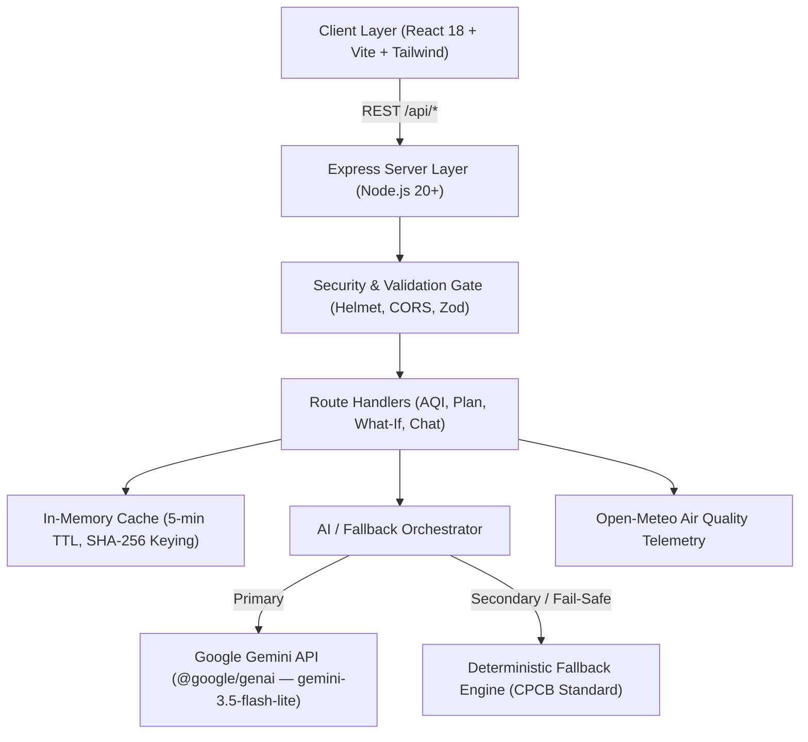

# Architectural Design & Engineering Specifications

The **Urban Air Quality Assistant** is architected as an edge-optimized, resilient, bilingual web application delivering personalized environmental risk reduction protocols during severe winter smog episodes.

---

## 1. Architectural Layers & Separation of Concerns

### Layer Responsibilities:
1. **Presentation Layer (`client/src`)**:
   - Component-driven UI built with React 18 and Tailwind CSS.
   - Design System supporting WCAG 2.1 AA/AAA contrast ratios, accessible screen reader cues (`aria-live="polite"`), and non-color dependent state indicators.
   - Dynamic bilingual internationalization (English & Hindi) without page reloads.
2. **Security & Validation Layer (`server/middleware`)**:
   - `helmet` security header injection (CSP, Permissions-Policy, HSTS, XFO).
   - Strict `zod` schema parsers preventing prototype pollution, injection, and buffer overruns.
   - Tiered IP rate limiting protecting endpoints from denial-of-service spikes.
3. **Domain & Business Logic Layer (`server/services`)**:
   - `geminiService.js`: High-speed AI inference orchestrator with 8-second timeout guard and candidate fallback chains (`gemini-3.5-flash-lite` -> `gemini-3.5-flash`).
   - `fallbackEngine.js`: 100% deterministic, offline-capable rule engine implementing official CPCB air quality indices and EPA exposure factor formulas.
   - `cacheService.js`: High-performance in-memory cache with automatic TTL expiry to reduce upstream API latency and quota consumption.

---

## 2. Key Design Patterns & Engineering Principles

- **Fail-Safe Default Pattern**: If external network interfaces, cloud APIs, or rate limits fail, the system never displays an unhandled error screen. Instead, the deterministic fallback engine immediately activates to deliver life-saving guidance.
- **Circuit Breaker / Timeout Guard**: Upstream Gemini calls are wrapped with an 8,000 ms timeout race condition, preventing serverless function hangs and ensuring instant user interaction.
- **Single Responsibility Principle (SRP)**: Handlers, schema validators, rate limiters, caching layers, and AI service clients are decoupled into modular ES modules.
- **Zero-Config Unified Packaging**: Static assets are pre-compiled and embedded directly into the server service bundle (`server/services/staticAssets.js`), enabling atomic single-command deployments on edge hosts like Vercel.

---

## 3. Telemetry & Scientific Formula Grounding

- **PM2.5 Inhalation Exposure Reduction**:
  $$\text{Dose Reduction \%} = 1 - \frac{\sum (C_{\text{micro}} \times V_E \times t)}{\text{Baseline Daily Exposure}}$$
- **Corsi-Rosenthal Box Clean Air Delivery Rate (CADR)**:
  $$\text{CADR} = \text{Airflow (CFM)} \times \text{Filter Efficiency (MERV-13: } \ge 90\% \text{ at } 0.3-1.0 \mu m)$$
- **Carbon Abatement Modeling**:
  $$\text{CO}_2 \text{ Saved (kg)} = \Delta \text{km} \times \text{Emission Factor (Metro vs ICE Vehicle)}$$
